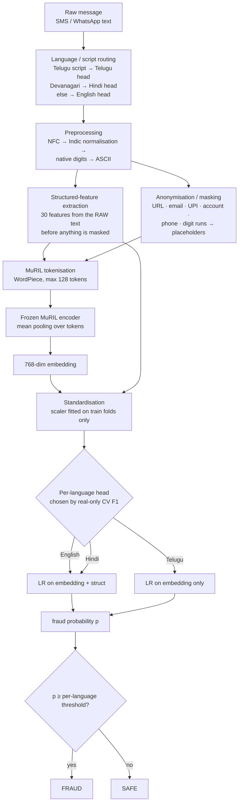
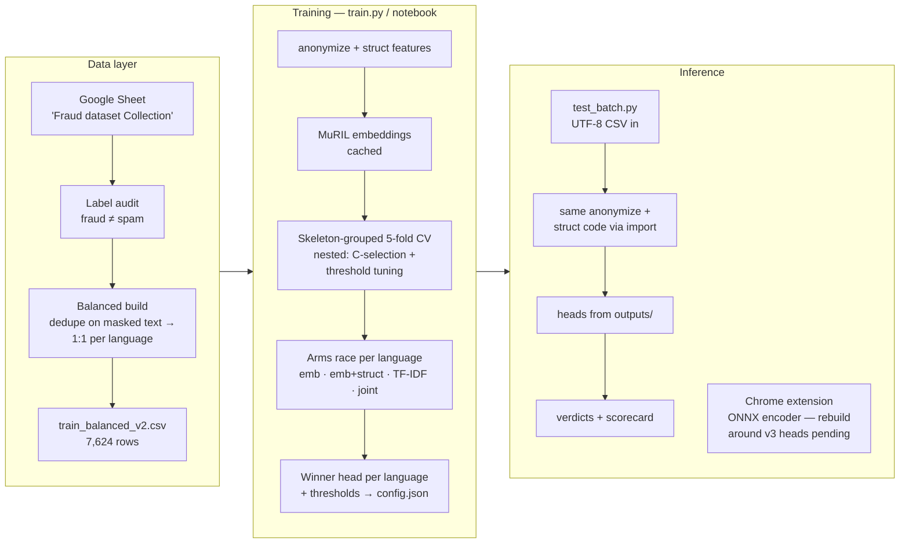
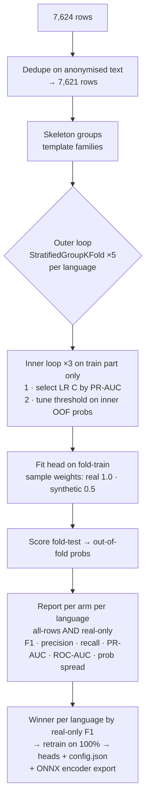

# VIGILORA.AI — Multilingual Fraud Message Detection

A fraud-message classifier for Indian financial SMS / WhatsApp messages in
**Telugu (native script), Hindi (Devanagari), Romanised Hinglish/Telugish and
English**. The system reads a message and answers one question — *fraud or
safe?* — with a probability, a per-language decision threshold, and a head
chosen per language by honest cross-validation.

- **Encoder:** frozen MuRIL (`google/muril-base-cased`) — embeddings only, never fine-tuned so far
- **Heads:** per-language logistic regression (embeddings, or embeddings + structured features)
- **Baseline arm:** word + character TF-IDF with logistic regression
- **Evaluation rule that governs everything:** skeleton-grouped cross-validation,
  thresholds tuned only inside training folds, and the headline metric is
  **real-only F1** (synthetic paraphrases may help training; they never inflate the score)
- **Current version:** v3 — real-only CV F1 **English 0.952 · Hindi 0.992 · Telugu 0.912**
  (with the data caveats in [Results](#results-v3))

---

## Table of contents

1. [End-to-end flow](#1-end-to-end-flow)
2. [How one message is converted, step by step](#2-how-one-message-is-converted-step-by-step)
3. [System architecture](#3-system-architecture)
4. [The dataset](#4-the-dataset)
5. [Preprocessing in depth](#5-preprocessing-in-depth)
6. [Structured features](#6-structured-features)
7. [Training in depth](#7-training-in-depth)
8. [Models used](#8-models-used)
9. [Results (v3)](#9-results-v3)
10. [Testing protocol](#10-testing-protocol)
11. [How to run](#11-how-to-run)
12. [Previous approaches and their outcomes](#12-previous-approaches-and-their-outcomes)
13. [The research that produced v3](#13-the-research-that-produced-v3)
14. [Limitations and future work](#14-limitations-and-future-work)
15. [File inventory](#15-file-inventory)

---

## 1. End-to-end flow



The same flow in plain words:

1. A raw message arrives exactly as the user received it — messy, mixed-script,
   with real numbers, links and amounts.
2. Its **script** decides the language route (Telugu characters → Telugu,
   Devanagari → Hindi, otherwise English). Romanised Hinglish/Telugish rides
   the English route unless labelled by hand — a known weakness, see Limitations.
3. The text is **normalised** so that the same word always becomes the same
   codepoints, then native digits are converted to ASCII digits.
4. **Before anything is hidden**, 30 structured features are extracted from the
   raw text (link type, phone presence, digit patterns, amount size, OTP
   context, warning wording). This step exists because of what v1 taught us —
   see [Previous approaches](#12-previous-approaches-and-their-outcomes).
5. Private/variable content is **masked** to placeholders (`[URL]`, `[PHONE]`,
   `[OTP]`, …) so the model learns message *patterns*, not specific numbers.
6. The masked text is tokenised by MuRIL's WordPiece tokeniser and passed
   through the **frozen** MuRIL encoder; token vectors are mean-pooled into one
   768-dimension embedding.
7. The embedding (plus structured features, for English/Hindi) is standardised
   and scored by that language's logistic-regression head.
8. The probability is compared with a **per-language threshold** tuned on
   validation data — never a global 0.5.

---

## 2. How one message is converted, step by step

Worked example — a real fraud pattern currently circulating (the "NO-reply"
debit-alert scam):

> మీ బ్యాంక్ ఖాతా నుంచి రూ. 70,000 డెబిట్ అయ్యాయి. ఈ లావాదేవీ మీరు చేయకపోతే వెంటనే NO అని రిప్లై ఇవ్వండి.

### Step 1 — Script routing
The text contains Telugu characters (U+0C00–U+0C7F) → routed to the **Telugu**
pipeline and, at the end, the Telugu head and Telugu threshold.

### Step 2 — Unicode NFC normalisation
`unicodedata.normalize("NFC", text)` gives every character one canonical
encoding, so visually identical strings are byte-identical.

### Step 3 — Indic normalisation (Indic NLP Library)
The language-specific normaliser (`te`) then canonicalises what NFC does not:

| Phenomenon | What happens |
|---|---|
| Zero-width joiner / non-joiner (U+200D / U+200C) | Removed — they vary by keyboard and change tokenisation |
| Zero-width space, BOM, no-break space | Removed / converted to a normal space |
| Nukta (e.g. क़, ज़) | Canonicalised to one representation (`remove_nuktas=False` — canonicalise, never delete) |
| Two-part dependent vowel signs / matras | Canonicalised to a single representation |
| Danda / poorna virama (।, ॥, `\|`) | Canonicalised to the standard Indic sentence ender |

If the library is unavailable, a built-in fallback still removes the
zero-width characters and normalises spaces. **The identical code runs at
training time and at prediction time** — any difference would be train/serve
skew.

### Step 4 — Native digit conversion
Telugu digits ౦–౯ and Devanagari digits ०–९ are mapped to ASCII 0–9, so
patterns written for digits work in every script. (In this example the amount
is already in ASCII digits.)

### Step 5 — Structured features are extracted from the raw text
30 numbers describing the message's *shape* (full list in
[§6](#6-structured-features)). For this message, among others:

- `n_digit_runs = 1`, `max_run_len = 5` ("70,000" → digit content)
- `amount_log10 ≈ 4.85` (largest amount ₹70,000 → log₁₀(1 + 70000))
- `has_currency = 1` (రూ. present), `mentions_debit = 1` (డెబిట్)
- `has_url = 0`, `has_phone = 0`, `otp_is_requested = 0`
- `mentions_do_not_share = 0` — no protective warning wording; the message
  instead *asks for a reply*, which real debit alerts never do

### Step 6 — Masking (anonymisation)
URLs → `[URL]`, emails → `[EMAIL]`, UPI ids → `[UPI]`, grouped/long digit
runs → `[ACCOUNT]`, Indian mobile numbers → `[PHONE]`, remaining 4–8-digit
runs → `[OTP]`. For this example the cleaned text becomes approximately:

```
మీ బ్యాంక్ ఖాతా నుంచి రూ. [OTP] డెబిట్ అయ్యాయి. ఈ లావాదేవీ మీరు చేయకపోతే వెంటనే NO అని రిప్లై ఇవ్వండి.
```

The amount `70,000` is masked in the text — but its *size* survives in the
structured features (`amount_log10`), which is exactly the v3 fix: masking no
longer deletes the signal, it moves it.

### Step 7 — Tokenisation
MuRIL's cased WordPiece tokeniser splits the cleaned text into subwords
(max length 128). Telugu costs roughly **2.02 tokens per word** in MuRIL
vs ≈1.40 for Devanagari — one reason Telugu needs the most care.

### Step 8 — Frozen MuRIL embedding
The token sequence passes through MuRIL (12 transformer layers, weights
frozen). Token vectors are **mean-pooled with the attention mask** (padding
excluded) into a single 768-dim vector.

### Step 9 — Standardisation + head
The embedding is standardised with a scaler fitted on training folds only.
For Telugu, the shipped head is logistic regression on the embedding alone;
for English/Hindi the 30 structured features are standardised and appended
first. The head outputs a probability `p(fraud)`.

### Step 10 — Threshold → verdict
`p` is compared with the Telugu threshold (tuned in nested CV; Telugu tuning
additionally prefers thresholds with validation precision ≥ 0.75).
`p ≥ threshold` → **FRAUD**, else **SAFE**.

**Contrast — a genuine alert** ("Rs.2,500 credited… Do not share your OTP.
Bank never asks for OTP") takes the identical path, but its structured
features differ where it matters: `mentions_do_not_share = 1`,
`mentions_never_ask = 1`, `otp_is_requested = 0`, no shortener link — and the
embedding lands on the ham side of the head. Teaching the model *this*
contrast — fake alerts imitate real ones word-for-word, so the difference
lives in context and structure, not vocabulary — is the core design idea.

---

## 3. System architecture



Two invariants hold the architecture together:

- **One preprocessing implementation.** `test_batch.py` imports `anonymize`
  and the feature extractor from `train.py`. There is no second copy to drift.
- **Honest evaluation is structural, not aspirational.** Grouped splits,
  nested tuning and real-only reporting are properties of the code path,
  not of anyone's intentions.

---

## 4. The dataset

**Single source of truth:** the Google Sheet *"Fraud dataset Collection"*
(Form responses 1), grown over months of sweeps — the user's own collected
messages, verbatim scam quotes from news / police / PIB / Truecaller
ScamFeed specimens, consumer-complaint posts, and flagged synthetic rows
(Hugging Face sets + paraphrases of the user's own seeds, always marked
`is_synthetic`).

**Training file (v2/v3): `train_balanced_v2.csv` — 7,624 rows**, built from
the live sheet (5,558 rows after excluding 21 UNCERTAIN + 2 Maybe) plus
2,316 carried-over English corpus rows (DIFrauD / seven-phishing):

| Language | Fraud | Ham | Notes |
|---|---|---|---|
| English | 2,785 | 2,785 | Corpus top-up on the fraud side |
| Hindi | 566 | 566 | Real ham pool is only **72 unique** messages — the rest is flagged synthetic |
| Telugu | 461 | 461 | Real pool after dedupe: **125 fraud / 150 ham** (incl. Romanised Telugish folded in) |

Build rules, in order: dedupe **first** on anonymised text (masking makes
rows that differ only in numbers identical — they are one template, not
many examples), then balance 1:1 per language, dropping synthetic rows
before real ones.

**The label audit (why the labels can be trusted more than the sources):**
an audit of the Telugu "fraud" seeds found ~35% were actually promotions,
legitimate service messages or government awareness messages mislabelled
as fraud — in the source corpora, *spam ≠ fraud*. 49 rows were relabelled
with an audit note, 21 uncertain rows are held out of training entirely,
and every synthetic row carries provenance. Hindi seeds were clean
(162 true fraud, 1 mislabel).

**The standing gap:** genuine Telugu/Hindi **ham** barely exists in public
sources. Sweeps collect Telugu/Hindi fraud verbatim easily; nobody
publishes a genuine Telugu bank alert. The best real source is the user's
own phone (an SMS-export anonymiser, `sms_ham_anonymizer.py`, exists for
exactly this). Every result in this README must be read with that gap in
mind — see [Results](#9-results-v3) caveats.

---

## 5. Preprocessing in depth

Pipeline (`anonymize()` in `train.py`, identical at train and serve):

1. NFC Unicode normalisation
2. Indic NLP Library normalisation (per script; fallback removes
   zero-width characters)
3. Native Telugu/Devanagari digits → ASCII
4. Masking, in order: URLs → emails → UPI ids → grouped account numbers →
   12–18-digit runs → Indian mobiles → remaining 4–8-digit runs → `[OTP]`
5. Whitespace collapse

**Deliberately NOT done** (each is a classical TF-IDF-era step that the
research showed *hurts* a MuRIL pipeline):

- **No lowercasing** — `muril-base-cased` is a cased model; case was
  preserved in its pretraining on purpose.
- **No stemming / lemmatisation** — subword tokenisation *is* the
  morphology handling; stemming first produces strings that never
  occurred in pretraining (and Telugu is agglutinative — crude suffix
  stripping mangles stems).
- **No stopword removal** — in fraud SMS the function words carry the
  label: "bank will **never** ask", "**do not** share". Removing negation
  inverts exactly the legitimate warnings the model used to misflag.
- **No punctuation/danda stripping, no digit deletion in the text branch** —
  patterns and structure are signal (they are captured as features, §6).
- **No translation to English** — it destroys fraud cues, code-switching
  and Romanised spelling, and adds a network dependency.
- **No script unification** (e.g. forcing everything into Devanagari) —
  MuRIL was pretrained with each language in its native script plus
  transliterations; keep native scripts native.

**Digit handling trade-off, stated honestly:** the blanket 4–8-digit rule
also masks genuine amounts in the text (a bare "5000" becomes `[OTP]`).
v1/v2 accepted this silently; a masking audit (see §13) counted **7,284 of
7,452 English** digit runs masked with no OTP word nearby — amounts and
reference numbers. v3 keeps the masking (privacy + train/serve
consistency) but recovers the information as structured features before
the mask is applied.

**Skeleton (for splitting):** a message's template family — anonymised
text, lowercased, placeholders and punctuation removed. Two messages with
the same skeleton are the same template with different numbers.

---

## 6. Structured features

30 features extracted from the **raw** message (after digit conversion,
before masking), standardised and concatenated to the embedding for the
arms/heads that use them:

- **Shape:** `n_chars`, `n_words`, exclamation/question counts, Latin caps ratio
- **Digits:** `digit_ratio`, `n_digit_runs`, `max_run_len`, `has_long_digit_run`
- **Links & contact:** `has_url`, `n_urls`, `url_is_shortener` (bit.ly,
  tinyurl, …), `url_has_ip`, `has_email`, `has_upi`, `has_phone`
- **Money:** `has_currency`, `has_amount`, `amount_log10` (log-scaled
  largest amount — magnitude generalises, raw values do not)
- **OTP context:** `mentions_otp`, `otp_word_near_digits`, and
  `otp_is_requested` — an OTP *requested* with share/send/reply wording and
  **no** do-not-share warning is the fraud pattern; an OTP *delivered*
  alongside a warning is the real-bank pattern
- **Protective wording:** `mentions_do_not_share`, `mentions_never_ask`
- **Action/threat cues:** `mentions_debit`, `mentions_credit`,
  `mentions_blocked`, `mentions_kyc`, `mentions_prize`, `mentions_click`
  (keyword sets include Telugu and Hindi terms, e.g. డెబిట్, ఓటిపి, डेबिट, ओटीपी)

Why these exist: a fake debit alert is *engineered* to share its body text
with a real one. Bank guidance itself says the real discriminators are
sender/link behaviour and whether an OTP is being requested — none of
which is body vocabulary. §13 has the evidence trail.

---

## 7. Training in depth



Key mechanics:

- **Grouped splits.** `StratifiedGroupKFold` on the skeleton: a template
  family never straddles train and test. Random splits would leak
  near-identical templates and inflate every metric — the project's
  founding lesson (§12, the RoBERTa incident).
- **Nested tuning.** Inside each outer fold, an inner 3-fold grouped CV
  (a) selects the logistic-regression strength `C` from
  {0.01, 0.1, 1, 10, 100} by PR-AUC and (b) tunes the decision threshold
  on inner out-of-fold probabilities. Test rows influence neither.
- **Class/sample weighting.** `class_weight="balanced"`; real rows weigh
  1.0, synthetic rows 0.5 in every fit.
- **Telugu precision floor.** Telugu threshold tuning prefers thresholds
  whose inner-validation precision is ≥ 0.75, falling back to best-F1 —
  a direct attack on the Telugu ham false-alarm pattern.
- **Frozen encoder, cached embeddings.** MuRIL weights never move;
  embeddings are computed once and cached (keyed by model + preprocessing
  version, so v2/v3 embeddings can never mix).
- **Arms race.** Four configurations are evaluated on identical splits:
  embeddings only · embeddings + structured · word+char TF-IDF · pooled
  joint embeddings+structured. The winner per language is what ships;
  losing arms are reported, not hidden.
- **Final export.** Winning heads retrained on 100% of their data,
  saved as joblib objects + `config.json` (thresholds, head choice per
  language, feature names), plus the MuRIL encoder exported to ONNX.

---

## 8. Models used

| Component | Model | Role |
|---|---|---|
| Encoder | **MuRIL** `google/muril-base-cased` (BERT-base, WordPiece vocab 197,285) | Frozen text encoder for Telugu + Hindi + English + Romanised text; pretrained on 17 Indian languages incl. transliterated pairs |
| Heads (shipped) | **Logistic regression** (scikit-learn), standardised inputs, per-language C | English + Hindi: on embedding + structured features. Telugu: on embedding only |
| Baseline arm | **TF-IDF** word (1–2g) + char_wb (3–5g) → logistic regression | The diagnostic baseline every embedding result must beat |
| Comparison arm | Joint logistic head over all languages | Tests whether pooling helps small languages (it did not, in v3) |
| Researched, not used | IndicBERT, XLM-R, HingRoBERTa | Compared in the research (§13) on tokeniser fertility and pretraining fit; MuRIL's transliteration pretraining is the reason it stays |
| Historical | RoBERTa (leaky run), TF-IDF + LR (Sept baseline) | See §12 |

---

## 9. Results (v3)

Cross-validation on the v2 dataset (7,621 deduped rows), **real-only**
metrics at the tuned per-language threshold:

| Language | Arm | F1 | Precision | Recall | ROC-AUC | Real n |
|---|---|---|---|---|---|---|
| English | emb only | 0.950 | 0.953 | 0.946 | 0.988 | 5,032 |
| English | **emb + struct (shipped)** | **0.952** | 0.951 | 0.954 | 0.989 | 5,032 |
| English | TF-IDF | 0.947 | 0.935 | 0.959 | 0.988 | 5,032 |
| English | joint emb+struct | 0.948 | 0.956 | 0.941 | 0.986 | 5,032 |
| Hindi | emb only | 0.989 | 0.989 | 0.989 | 0.983 | 248 |
| Hindi | **emb + struct (shipped)** | **0.992** | 0.989 | 0.994 | 0.989 | 248 |
| Hindi | TF-IDF | 0.986 | 0.989 | 0.983 | 0.998 | 248 |
| Hindi | joint emb+struct | 0.971 | 0.988 | 0.955 | 0.976 | 248 |
| Telugu | **emb only (shipped)** | **0.912** | 0.870 | 0.960 | 0.960 | 273 |
| Telugu | emb + struct | 0.897 | 0.830 | 0.976 | 0.954 | 273 |
| Telugu | TF-IDF | 0.887 | 0.837 | 0.944 | 0.957 | 273 |
| Telugu | joint emb+struct | 0.829 | 0.760 | 0.912 | 0.906 | 273 |

Versus v1 (same honest protocol): English **0.845 → 0.952**, Hindi
**0.784 → 0.992**, Telugu **0.686 → 0.912**; Telugu real-only precision
**0.56 → 0.87** and Telugu false alarms **84 FP → 18 FP**. Predicted
probabilities now spread across the range (std ≈ 0.44) instead of
clustering at the threshold.

**Attribution, honestly:** all v3 arms share one dataset, and emb-only
alone captures nearly all of the gain — the fix was the **head
(standardisation + C-selection) and the Indic normalisation**, not the
structured features. Structured features added +0.002 (English) / +0.003
(Hindi) and **hurt Telugu** (−0.015, more false positives), which is why
Telugu ships emb-only. English selected C = 0.01 in every fold: v1's
fixed-C head on unscaled embeddings was the single biggest defect.
One confound cannot be removed: v2 (the bigger dataset with the old
head) was never run, so dataset-vs-pipeline credit cannot be split
perfectly — the within-v3 arm comparison is the evidence for the claim
above.

**Caveats that must travel with these numbers:**

- Hindi real-only n = 248, of which only **72 are ham**; Telugu real
  n = 273. The CV protocol is honest, but thin real ham means field
  performance will be lower. **Do not quote "99% Hindi accuracy"** as a
  field claim.
- CV measures messages *like the collected data*. Truly new messages
  behave worse — see the unseen-message test below.

### Unseen-message test (30 messages, zero training overlap)

`test_new_messages.csv` — the 6 original examples that the v1-era model
scored 0.51–0.59 (all flagged fraud) + 24 new written examples:

| Scope | Accuracy | Precision | Recall | F1 |
|---|---|---|---|---|
| All | 0.867 | 0.789 | **1.000** | 0.882 |
| English | 1.000 | 1.000 | 1.000 | 1.000 |
| Hindi | 0.900 | 0.833 | 1.000 | 0.909 |
| Telugu | 0.700 | 0.625 | 1.000 | 0.769 |

Reading: every fraud was caught (recall 1.0); the remaining error is
concentrated exactly where it always was — **Telugu ham false alarms**
(3 of 5 Telugu ham flagged). A second test file,
`test_latest_real_messages.csv` (34 verbatim real messages collected from
news/police/bank sources — 19 fraud, 15 ham), is prepared for the next
run. The decisive field test — 10–15 fresh messages per language copied
from a real phone — is still outstanding.

---

## 10. Testing protocol

1. **Never paste Telugu/Hindi into a Windows console.** PowerShell's
   encoding mangles the script into mojibake; the language router then
   falls back to the English head and the "test" measures the console,
   not the model. Always test through a UTF-8 CSV with `test_batch.py`.
2. Test messages must be **checked for overlap** against training
   (skeleton + cleaned text) before they count as "unseen".
3. **Never tune thresholds on the test set.** Read the errors, fix the
   cause in training, re-judge on a fresh test.
4. Report per-language precision/recall/F1 — a single accuracy number
   hides the Telugu ham problem, which is the problem that matters.

---

## 11. How to run

```bash
# In a FRESH folder (never overwrite a previous version's outputs —
# before/after comparison is the evidence)
pip install -r requirements.txt
python diagnose.py                        # Phase-0 audit (tokeniser, masking)
python train.py                           # full CV + final heads + ONNX export
python test_batch.py test_new_messages.csv
python test_batch.py test_latest_real_messages.csv
```

Or use **`fraud_training_v3.ipynb`** — the identical pipeline split into
Jupyter cells (on Colab, select the T4 GPU runtime first; the embedding
step is slow on CPU). First run downloads MuRIL (~950 MB); embeddings are
cached in `outputs/` afterwards.

Outputs: `outputs/cv_results.json` (per-arm, per-language metrics),
`outputs/oof_probs.npz`, `outputs/head_*.joblib`,
`outputs/model/config.json` + `model.onnx` + tokenizer files.

---

## 12. Previous approaches and their outcomes

The current design is the residue of four earlier approaches. Each failed
in a different, instructive way.

### Approach 0 — TF-IDF + logistic regression on a mutation dataset (Sep 2025)
Dataset: 5,108 rows built by mutating 220 real fraud seeds. TF-IDF
(char_wb 3–5) + LR (C=2.0, balanced), seed-grouped splits.
**Outcome:** 85.07% accuracy on the augmented test (F1 0.909, n=864),
**90.62% on a 32-message pure-real holdout (F1 0.94)**. Honest and
leakage-free — but the dataset was mutations of few seeds, the model was
English-centric, and the holdout was tiny (n=32, ±~10 points).
**Lesson kept:** quote the real holdout, not the augmented test.

### Approach 1 — RoBERTa fine-tune (pre-Oct 2025)
**Outcome:** scored **1.00** — and failed on new real messages. The
near-perfect score was leakage: near-identical mutations of the same
seeds sat in both train and test, and RoBERTa's Telugu/Hindi
understanding was weak to begin with.
**Lesson kept (the project's founding rule):** near-100% is a leakage
defect, never a success. This is why every later evaluation is
skeleton-grouped with a real-only headline.

### Approach 2 — v1: frozen MuRIL + per-language LR heads (24 Oct 2026)
The first honest transformer run (run by the author on his own laptop):
frozen MuRIL embeddings, per-language LR (fixed C=1.0, unscaled),
NFC-only cleaning, full masking, nested per-language thresholds.
**Outcome (real-only F1):** English 0.845 · Hindi 0.784 (joint 0.824) ·
Telugu **0.686**, with Telugu precision **0.56** — 84 false positives
against 66 true negatives on real Telugu rows. On hand-tested messages,
**every probability landed between 0.51 and 0.59**: a 6-message batch
test flagged all six messages FRAUD (3 fraud correct, all 3 ham wrong).
The model had ranking signal but no confidence and a Telugu
false-alarm habit.
**Diagnosis at the time:** Telugu ham shortage + threshold issues.
**What it actually was:** see Approach 4 — the diagnosis was incomplete.

### Approach 3 — v2: bigger dataset, same head (built 24 Oct 2026, never run)
Training file rebuilt from the live sheet (7,624 rows, real=1.0 /
synthetic=0.5 sample weights, automatic own-vs-joint head choice,
onnxscript added). The planned SVM/C-tuning/calibration from the rebuild
spec did **not** make it into the shipped code — the head was still
fixed-C, unscaled.
**Outcome:** never run; superseded by v3 within a day, when the author
reported the scores were "still just 50–60". v2's dataset survives as
the v3 training file, which makes the v1→v3 comparison possible.

### Approach 4 — Research, audit, then v3 (25 Oct 2026)
Instead of tweaking blindly: a sourced research pass on how others
preprocess Telugu/Hindi (§13), then an **audit of v2's own code**
against the research suspects. All four suspects were confirmed in the
code, one of them measured:

1. **Masking deleted the signal** — 7,284/7,452 English (381/398 Hindi,
   269/273 Telugu) 4–8-digit runs were masked as `[OTP]` with no OTP
   word nearby: amounts, dates and reference numbers, i.e. the very
   features that separate a fake alert from the real one it imitates.
2. **NFC-only normalisation** — v2 even *kept* ZWJ/ZWNJ deliberately;
   visually identical words tokenised differently across keyboards.
3. **Underfit head** — fixed C=1.0 on raw 768-dim embeddings with
   balanced class weights shrinks logits toward the intercept:
   probabilities *must* cluster near the prior. This, more than
   anything, was the 0.51–0.59 symptom.
4. **No baseline + placeholder hazard** — no TF-IDF arm to localise the
   fault, and the `[OTP]`-style placeholders were never registered as
   special tokens, so WordPiece splits them into pieces.

**v3 fixes:** Indic normalisation; 30 structured features extracted
before masking; standardisation + C selected by inner CV; a TF-IDF arm
and a joint arm raced on identical splits; Telugu precision floor.
**Outcome:** §9 — F1 0.952 / 0.992 / 0.912, Telugu precision 0.56 → 0.87,
probability spread restored. And the arms race produced a finding worth
more than the fix list: the structured features were **not** the hero —
the head and the normalisation were. Telugu still false-alarms on new
ham (§9 unseen test); that is now a data problem (real Telugu ham
scarcity), not a pipeline problem, and it is being treated as one.

---

## 13. The research that produced v3

A dedicated research pass (papers, model cards, Indic NLP documentation;
full sourced report preserved in the project research notes) answered
seven questions. The findings that changed the code:

- **Indic normalisation is a real layer beyond NFC.** The Indic NLP
  Library normaliser removes ZWJ/ZWNJ, canonicalises nukta and two-part
  vowel signs, and standardises danda/poorna virama. The Dakshina
  dataset paper independently reports needing "extensive additional
  visual normalisation beyond NFC" for the same reason: visually
  identical strings encoded differently.
- **Tokeniser economics differ per script.** MuRIL fertility ≈ 1.40
  tokens/word for Devanagari vs ≈ 2.02 for Telugu — Telugu messages are
  truncated sooner and pooled thinner at the same max length. MuRIL's
  card also states case is preserved deliberately and recommends
  fine-tuning all parameters; its frozen pooled scores are its weakest
  mode (transliterated Telugu Tatoeba 17.52 — Roman Telugu is MuRIL's
  weak corner).
- **Classical preprocessing belongs to TF-IDF models.** Published
  Telugu/Hindi SMS work is mostly TF-IDF + NB/SVM/RF with lowercasing,
  stopword removal and stemming — gains there are vocabulary-sparsity
  effects. In the transformer branch those steps remove negation and
  produce out-of-pretraining strings. (One DravidianLangTech MuRIL
  paper did use stopword removal — with no ablation; noted, not copied.)
- **Character n-grams are a serious baseline on small Indic data.**
  Char 3-gram + LR was the best of 42 configurations in a 2026 English
  SMS benchmark (98.55% acc); Telugu char-TF-IDF ≈ word-TF-IDF in
  Dravidian tasks. Hence the mandatory TF-IDF arm — and it nearly won
  Telugu in v3 (0.887 vs 0.912), which is itself diagnostic.
- **Metadata features beat body text for imitative fraud.** Dravidian
  SMS work gains from digit counts, URL presence, length and ratios;
  bank guidance says genuine-vs-fake turns on sender behaviour, link
  type and whether an OTP is *requested*. This is the evidence behind
  §6's structured features — with the honest footnote that **no published
  paper ablates masking specifically for Indian bank-fraud SMS**; the
  masking conclusion is convergent inference, tested here by the arm
  race (result: real but small — the head mattered more).
- **Frozen vs fine-tuned is task-dependent.** Indic experiments show
  frozen ≈ fine-tuned on saturated classification and large gaps on
  harder tasks. Fine-tuning MuRIL (lr 2–3e-5, batch 32, len 128, early
  stopping) is the documented next lever — §14.
- **Romanised text: keep it Roman for MuRIL.** Its transliteration
  pretraining is its edge (PANX transliterated 57.70 vs mBERT 14.24).
  IndicXlit transliteration is an augmentation candidate, never the
  sole view; no Roman-Telugu equivalent of HingBERT/HingRoBERTa exists.
- **Calibration at this scale:** sigmoid/Platt, not isotonic (which
  overfits ≪1,000 samples) — noted for the threshold work ahead.

Primary sources: MuRIL model card & paper (arXiv:2103.10730), Indic NLP
Library normalisation docs, IndicBERT model card (AI4Bharat), Dakshina
paper (arXiv:2007.01176), *Revisiting SMS Spam Detection* (Electronics
2026), Ramanujam et al. Dravidian Spam SMS (ICDSNE 2023), Sentence-BERT
(arXiv:1908.10084), L3Cube HingCorpus/HingBERT (arXiv:2204.08398),
scikit-learn calibration docs, Kotak's fake-SMS guidance.

---

## 14. Limitations and future work

- **Real Telugu/Hindi ham scarcity** is the binding constraint. Hindi
  CV rests on 72 unique real ham; Telugu's unseen-test precision
  (0.625) is the visible symptom. Fix is data (phone SMS exports,
  anonymised), not more pipeline.
- **Telugu/Hindi genuine ham in public sources ≈ 0** — confirmed again
  by the latest-message sweep (15 real ham found, all English).
- **Romanised routing:** script-based routing sends Hinglish/Telugish
  to the English route. A script/language indicator feature and
  Roman-specific handling are open work.
- **Fine-tuning MuRIL** (all parameters or last 2–4 layers) is the
  researched next lever if more real data lands; frozen embeddings are
  a baseline, not the ceiling.
- **Chrome extension** currently ships a demo-stub model. The v3 heads
  are the first candidates worth porting: Telugu is embedding-only
  (simplest); English/Hindi additionally need the structured features
  implemented in JavaScript and the anonymiser ported exactly.
- **Sender metadata** (sender ID / header) is the strongest known
  discriminator the current features cannot see, because the dataset
  holds message bodies only.

---

## 15. File inventory

| File | What it is |
|---|---|
| `train.py` (v3) | The full pipeline: preprocessing, features, embeddings, arms, export |
| `fraud_training_v3.ipynb` | The same pipeline as Jupyter cells |
| `diagnose.py` | Phase-0 audit: tokeniser fertility/UNK, placeholder tokenisation, masking audit |
| `test_batch.py` | Batch-test trained heads on a UTF-8 CSV; prints scorecard |
| `train_balanced_v2.csv` | Training data (7,624 rows) |
| `test_messages.csv` | The original 6 example messages |
| `test_new_messages.csv` | 30 unseen messages (6 regression + 24 new) |
| `test_latest_real_messages.csv` | 34 verbatim real messages from sources (19 fraud / 15 ham) |
| `requirements.txt` | numpy, pandas, scikit-learn, joblib, torch, transformers, onnx, onnxscript, indic-nlp-library |
| `outputs/cv_results.json` | Per-arm, per-language CV metrics |
| `outputs/model/` | config.json (thresholds, head choices), ONNX encoder, tokenizer |

---

*Every number in this README comes from a recorded run: the September
2025 baseline evaluation, the v1 run of 24 Oct 2026, or the v3 run of
25 Oct 2026, all executed on the author's machine. Where a number rests
on thin data, the README says so next to the number.*
